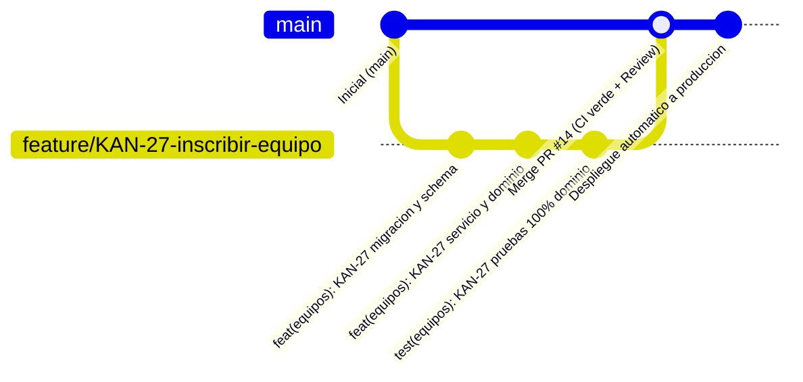
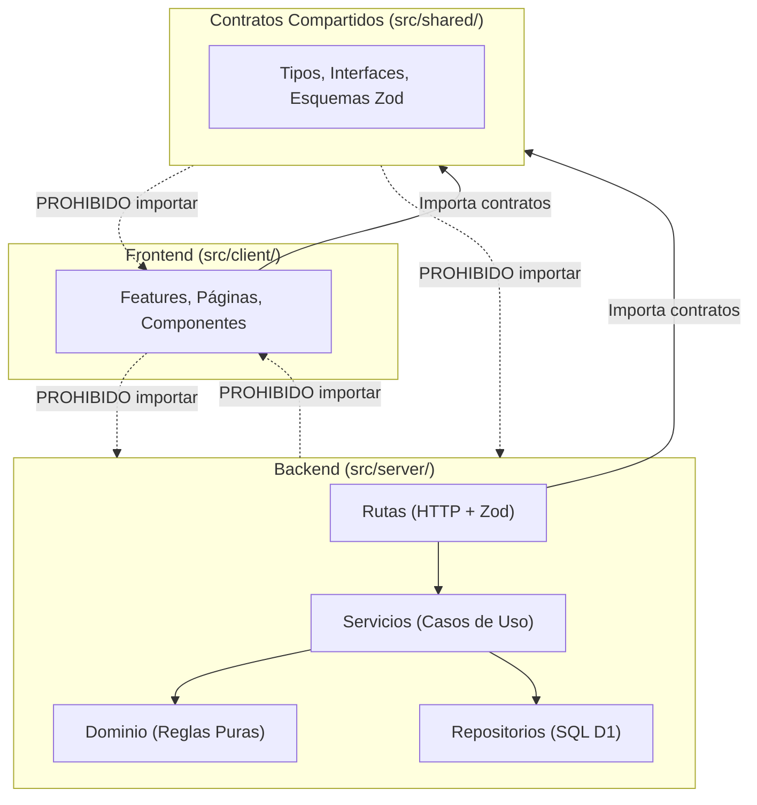

# Guía de Desarrollo y Flujo de Trabajo del Equipo

> **Proyecto:** Campeonatos UEB · Universidad El Bosque (2026)  
> **Asignatura:** Tendencias Avanzadas en Ingeniería de Software Asistida por IA  
> **Repositorio:** [daniachury/ueb-campeonatos-futbol](https://github.com/daniachury/ueb-campeonatos-futbol)  
> **Tablero Jira:** [Jira · UEB-IngSoftware2026 (KAN)](https://unbosque-team-ing-soft-2026.atlassian.net/jira/software/projects/KAN/boards/1)

---

## 🎯 Propósito del Documento

Este documento establece el **estándar único y obligatorio** de desarrollo, flujo de trabajo en Git/GitHub, convención de ramas y commits con Jira, arquitectura modular, gestión de base de datos relacional D1 y aseguramiento de calidad (DoD).

El objetivo es que **todos los integrantes del equipo trabajemos bajo el mismo esquema**, garantizando calidad continua, evitando colisiones de código y asegurando que cada funcionalidad llegue a producción de forma limpia y automatizada.

---

## 📑 Tabla de Contenidos

1. [Las 10 Reglas de Oro del Equipo](#1-las-10-reglas-de-oro-del-equipo)
2. [Requisitos Previos y Entorno Local](#2-requisitos-previos-y-entorno-local)
3. [Flujo de Trabajo Git + Jira (Paso a Paso)](#3-flujo-de-trabajo-git--jira-paso-a-paso)
4. [Convenciones de Ramas, Commits y Pull Requests](#4-convenciones-de-ramas-commits-y-pull-requests)
5. [Arquitectura del Proyecto y Fronteras de Capas](#5-arquitectura-del-proyecto-y-fronteras-de-capas)
6. [Gestión de Base de Datos (Cloudflare D1 y Migraciones)](#6-gestión-de-base-de-datos-cloudflare-d1-y-migraciones)
7. [Pruebas, Cobertura y Calidad de Código](#7-pruebas-cobertura-y-calidad-de-código)
8. [Checklist de Entrega (Definition of Done)](#8-checklist-de-entrega-definition-of-done)
9. [Guía Rápida de Comandos (Cheatsheet)](#9-guía-rápida-de-comandos-cheatsheet)
10. [Solución de Problemas Comunes (Troubleshooting)](#10-solución-de-problemas-comunes-troubleshooting)

---

## 1. Las 10 Reglas de Oro del Equipo

> [!IMPORTANT]
> Estas reglas protegen el repositorio principal y el despliegue en producción. Su cumplimiento es obligatorio en cada Pull Request.

1. **Cero commits directos a `main`:** Nadie sube cambios directamente a la rama `main`. Todo cambio entra mediante Pull Request (PR).
2. **Todo cambio tiene una historia en Jira:** Cada rama, commit y título de PR debe incluir la clave de Jira asignada (ejemplo: `KAN-27`).
3. **Inmutabilidad estricta de migraciones:** Jamás se edita ni se borra un archivo SQL ya existente en `migrations/`. Todo cambio al esquema de base de datos requiere una **nueva migración consecutiva**.
4. **Fronteras de capas inviolables (ESLint):**
   - El frontend (`src/client/`) **nunca** importa archivos de `src/server/`.
   - El backend (`src/server/`) **nunca** importa archivos de `src/client/`.
   - Todo tipo, DTO o esquema compartido vive en `src/shared/`.
   - Las pruebas E2E son de caja negra: nunca importan código de `src/`.
5. **Cobertura de pruebas $\ge$ 80%:** No se aceptan PRs que disminuyan la cobertura global de líneas por debajo del 80%. Vitest y el CI de GitHub rechazarán la entrega.
6. **Validación universal con Zod:** Las validaciones de entrada en la API y los formularios del cliente deben usar los mismos esquemas de Zod definidos en `src/shared/`.
7. **Reglas de negocio puras en `domain/`:** La lógica crítica (cálculo de tablas, desempates, sorteos, validación de cupos) debe ser código puro sin I/O, sin dependencias de base de datos ni de HTTP, probado al 100% con pruebas unitarias.
8. **Manejo uniforme de errores:** En el servidor se utiliza `AppError` (`src/server/core/errors.ts`) con códigos estandarizados (`NO_ENCONTRADO`, `CONFLICTO`, `NO_AUTORIZADO`, etc.).
9. **Verificación local completa antes de hacer push:** Siempre correr localmente `npm run typecheck`, `npm run lint`, `npm run format:check` y `npm run test:coverage` antes de enviar cambios al remoto.
10. **Revisión por pares (Peer Review):** Todo PR requiere la aprobación de al menos un compañero de equipo y la suite de GitHub Actions en verde para poder hacer merge.

---

## 2. Requisitos Previos y Entorno Local

### 2.1 Herramientas Requeridas

| Herramienta | Versión requerida                        | Verificación |
| :---------- | :--------------------------------------- | :----------- |
| **Node.js** | `>= 22.0.0` (indicado en `.nvmrc`)       | `node -v`    |
| **npm**     | `>= 10.0.0` (gestor de paquetes oficial) | `npm -v`     |
| **Git**     | `>= 2.40.0`                              | `git -v`     |
| **VS Code** | Recomendado con extensiones del proyecto | —            |

> [!WARNING]
> Usar únicamente `npm`. **No utilices `yarn` ni `pnpm`** para evitar inconsistencias en el archivo `package-lock.json`, ya que el pipeline de integración continua (CI) en GitHub ejecuta estrictamente `npm ci`.

### 2.2 Extensiones Recomendadas en VS Code

Al abrir el proyecto, VS Code sugerirá instalar las extensiones declaradas en `.vscode/extensions.json`:

- **ESLint** (`dbaeumer.vscode-eslint`): Resalta errores de frontera y estilo en tiempo real.
- **Prettier** (`esbenp.prettier-vscode`): Aplica el formato automático al guardar.
- **EditorConfig** (`editorconfig.editorconfig`): Asegura saltos de línea UTF-8 e indentación coherente.

### 2.3 Puesta en Marcha Paso a Paso

1. **Clonar el repositorio:**

   ```bash
   git clone https://github.com/daniachury/ueb-campeonatos-futbol.git
   cd ueb-campeonatos-futbol
   ```

2. **Configurar variables de entorno locales:**
   Copiar la plantilla de variables de entorno para el Worker:
   - En Windows (PowerShell):
     ```powershell
     Copy-Item .dev.vars.example .dev.vars
     ```
   - En Linux / macOS / Bash:
     ```bash
     cp .dev.vars.example .dev.vars
     ```

3. **Instalar dependencias exactas:**

   ```bash
   npm install
   ```

4. **Inicializar la base de datos local (Cloudflare D1 en SQLite):**

   ```bash
   # Aplica todas las migraciones SQL consecutivas en .wrangler/
   npm run db:migrate:local

   # Inserta los datos iniciales de prueba (usuarios, torneos, equipos de ejemplo)
   npm run db:seed:local
   ```

5. **Iniciar el servidor de desarrollo:**

   ```bash
   npm run dev
   ```

6. **Verificar que todo funciona:**
   - **Aplicación Web:** Abrir en el navegador [http://localhost:5173](http://localhost:5173). Debe mostrar la cartelera de torneos.
   - **Endpoint de Salud (Backend + D1):** [http://localhost:5173/api/health](http://localhost:5173/api/health). Debe responder `{"estado":"ok","baseDeDatos":"ok"}`.

> [!NOTE]
> No necesitas una cuenta de Cloudflare ni iniciar sesión con `wrangler login` para desarrollar y probar en local; todo corre localmente con SQLite emulado.

---

## 3. Flujo de Trabajo Git + Jira (Paso a Paso)

El equipo utiliza un flujo **Trunk-Based Development con ramas de funcionalidad cortas (Feature Branches)** integradas directamente con Jira mediante la clave `KAN-##`.



### Ciclo de Vida de una Tarea

1. **Tomar la historia en Jira:**
   - Ir al tablero [Jira KAN](https://unbosque-team-ing-soft-2026.atlassian.net/jira/software/projects/KAN/boards/1).
   - Asignarse la historia y moverla de **Por hacer** a **En curso**.
   - Anotar la clave de Jira (ejemplo: `KAN-30`).

2. **Actualizar la rama `main` local:**

   ```bash
   git checkout main
   git pull origin main
   ```

3. **Crear la rama de trabajo:**
   Crear la rama a partir del `main` actualizado, siguiendo el formato obligatorio:

   ```bash
   git checkout -b feature/KAN-30-administrador-elimina-jugadores
   ```

4. **Desarrollar aplicando TDD / Clean Architecture:**
   - Implementar el contrato en `src/shared/`.
   - Implementar reglas de dominio y sus pruebas en `domain/`.
   - Implementar consultas SQL en `*.repository.ts`.
   - Implementar casos de uso en `*.service.ts`.
   - Exponer y validar rutas en `*.routes.ts`.
   - Conectar la interfaz React en `src/client/features/`.

5. **Hacer commits atómicos con formato estandarizado:**

   ```bash
   git add .
   git commit -m "feat(equipos): KAN-30 permite al administrador desvincular jugadores de un equipo"
   ```

6. **Mantener la rama sincronizada con `main`:**
   Antes de abrir o completar el PR, incorpora los cambios que otros compañeros hayan subido a `main`:

   ```bash
   git fetch origin
   git merge origin/main
   # Si hay conflictos, resolverlos cuidadosamente, verificar pruebas y commitear.
   ```

7. **Ejecutar la suite de calidad local:**

   ```bash
   npm run lint
   npm run typecheck
   npm run format:check
   npm run test:coverage
   ```

8. **Subir la rama al repositorio remoto:**

   ```bash
   git push -u origin feature/KAN-30-administrador-elimina-jugadores
   ```

9. **Abrir Pull Request en GitHub:**
   - Crear el PR apuntando a `main`.
   - GitHub cargará automáticamente la plantilla `.github/pull_request_template.md`.
   - Completar todos los campos y marcar cada punto del checklist de calidad.

10. **Revisión y Merge:**
    - Verificar que el workflow de **CI** esté completamente en verde (incluido el comentario automático de cobertura).
    - Solicitar revisión a al menos un miembro del equipo.
    - Una vez aprobado y en verde, realizar **Squash and merge** o **Merge commit** según lo acordado.
    - El workflow `deploy.yml` desplegará automáticamente la nueva versión a Cloudflare.
    - Mover la historia en Jira a **Listo / Finalizado**.

---

## 4. Convenciones de Ramas, Commits y Pull Requests

### 4.1 Nomenclatura de Ramas

Formato estricto: `<tipo>/<CLAVE-JIRA>-<descripcion-corta>`

| Prefijo     | Cuándo se usa                                         | Ejemplo                                        |
| :---------- | :---------------------------------------------------- | :--------------------------------------------- |
| `feature/`  | Nueva funcionalidad o historia de usuario             | `feature/KAN-27-unirse-a-equipo`               |
| `fix/`      | Corrección de un defecto o bug                        | `fix/KAN-52-calculo-diferencia-goles`          |
| `refactor/` | Reestructuración de código sin alterar comportamiento | `refactor/KAN-18-modularizar-servicios-auth`   |
| `test/`     | Adición o ajuste exclusivo de pruebas                 | `test/KAN-30-pruebas-unitarias-expulsion`      |
| `docs/`     | Documentación técnica, diagramas o manuales           | `docs/KAN-10-actualizar-diagrama-arquitectura` |
| `chore/`    | Mantenimiento, dependencias o configuración CI        | `chore/KAN-01-actualizar-wrangler-cloudflare`  |

### 4.2 Formato de Commits (Conventional Commits + Jira)

Formato: `<tipo>(<alcance>): KAN-## <descripción clara en imperativo/presente>`

Ejemplos:

- `feat(equipos): KAN-27 valida el cupo maximo de 25 jugadores`
- `fix(auth): KAN-16 corrige verificacion de hash PBKDF2 en contraseñas temporales`
- `test(torneos): KAN-22 añade casos limites al criterio de desempate por juego limpio`
- `refactor(client): KAN-46 desacopla sincronizacion de estados en MisEquiposPage`
- `docs(readme): KAN-05 documenta variables de entorno para Cloudflare D1`

### 4.3 Formato de Pull Requests

- **Título:** Debe iniciar con la clave de Jira en mayúsculas, seguida de dos puntos y el nombre de la historia:
  ```text
  KAN-30: Administrador elimina y desvincula jugadores de una nómina
  ```
- **Cuerpo del PR:** Utilizar obligatoriamente la plantilla predefinida:
  - Enlace a la historia de Jira (`KAN-XX · UEB-Proyect-XX`).
  - Lista de cambios realizados ("Qué cambia").
  - Pasos reproducibles para probarlo localmente ("Cómo probarlo").
  - Verificación del Checklist de Calidad (Definition of Done).

---

## 5. Arquitectura del Proyecto y Fronteras de Capas

El proyecto es un **Monolito Modular Serverless**:

```text
ueb-campeonatos-futbol/
├── migrations/             # Migraciones SQL inmutables para Cloudflare D1
├── seeds/                  # Datos SQL reproducibles para pruebas locales
├── src/
│   ├── server/             # BACKEND: Hono sobre Cloudflare Workers
│   │   ├── app.ts          # Enrutamiento central, middlewares y seguridad
│   │   ├── core/           # Utilidades transversales (errores, contexto, env)
│   │   └── modules/        # Módulos por dominio de negocio (épicas de Jira)
│   │       ├── admin/      # Gestión y estadísticas de administrador
│   │       ├── auth/       # Sesiones, login, registro y hash seguro
│   │       ├── equipos/    # Plantillas, nómina y solicitudes de jugadores
│   │       ├── torneos/    # Fases, tablas de posiciones y desempates
│   │       └── partidos/   # Fechas, goles, actas y arbitraje
│   ├── client/             # FRONTEND: React 19 + React Router + CSS Modules
│   │   ├── app/            # Rutas globales y layout principal
│   │   ├── common/         # Componentes atómicos comunes, hooks y cliente HTTP
│   │   ├── features/       # Módulos frontend alineados al backend
│   │   └── styles/         # Tokens de diseño y variables (tema.css)
│   └── shared/             # CONTRATOS: DTOs, interfaces y esquemas Zod compartidos
└── e2e/                    # SUITE E2E: Pruebas de caja negra con Playwright
```

### 5.1 Reglas de Frontera y Modularidad (Vigiladas por ESLint)



1. **`src/shared/` es la única fuente de verdad:**
   Si se define un objeto `CrearEquipoDTO` o una validación `crearEquipoSchema`, se define aquí. Si el modelo cambia, el compilador alertará errores tanto en el backend como en el frontend de inmediato.
2. **Estructura interna de un módulo en `src/server/modules/<modulo>/`:**
   - `<modulo>.routes.ts`: Recibe la petición HTTP, valida con Zod (`zValidator`), extrae la sesión y llama al servicio.
   - `<modulo>.service.ts`: Coordina las operaciones del caso de uso. Si una regla falla, lanza `errores.conflicto(...)` o `errores.noEncontrado(...)`.
   - `<modulo>.repository.ts`: Ejecuta las consultas SQL parametrizadas (`prepare(...).bind(...)`) contra Cloudflare D1.
   - `domain/`: Funciones matemáticas y algorítmicas 100% puras (ejemplo: cálculo de puntos, ordenamiento de tabla de posiciones). **Cero dependencias de base de datos ni de framework**.

---

## 6. Gestión de Base de Datos (Cloudflare D1 y Migraciones)

Cloudflare D1 es una base de datos relacional SQLite distribuida en el Edge.

### 6.1 La Regla de Oro de las Migraciones

> [!CAUTION]
> **Las migraciones son inmutables.** Una vez creada y commiteada una migración en `migrations/`, **NUNCA** se debe editar, renombrar ni eliminar su archivo.

Si necesitas alterar una tabla, agregar una columna o cambiar un índice:

1. Crea una **nueva** migración consecutiva.
2. Escribe sentencias aditivas y compatibles (`ALTER TABLE ... ADD COLUMN ...`).

### 6.2 Cómo Crear y Aplicar una Nueva Migración

1. **Generar el archivo de migración:**

   ```bash
   npx wrangler d1 migrations create DB agregar_telefono_a_usuarios
   ```

   Esto creará un archivo nuevo con el siguiente número secuencial, por ejemplo:
   `migrations/0009_agregar_telefono_a_usuarios.sql`.

2. **Escribir las instrucciones SQL:**
   Abrir el archivo creado y redactar las instrucciones DDL necesarias:

   ```sql
   -- migrations/0009_agregar_telefono_a_usuarios.sql
   ALTER TABLE usuarios ADD COLUMN telefono TEXT;
   ```

3. **Aplicar la migración en tu entorno local:**

   ```bash
   npm run db:migrate:local
   ```

4. **Si necesitas actualizar datos de prueba (seeds):**
   Actualiza `seeds/local-completo.sql` para que los nuevos entornos locales de tus compañeros se inicialicen con los campos coherentes.

---

## 7. Pruebas, Cobertura y Calidad de Código

### 7.1 Filosofía de Pruebas

- **Ubicación co-localizada:** Cada archivo de prueba vive junto al archivo que valida:
  - `equipos.service.ts` $\rightarrow$ `equipos.service.test.ts`
  - `tabla.ts` $\rightarrow$ `tabla.test.ts`
  - `BotonAccion.tsx` $\rightarrow$ `BotonAccion.test.tsx`
- **Pruebas de Backend:** Corren bajo Node con repositorios simulados o con la base en memoria `d1-falsa.ts` para pruebas de integración de rutas (`app.request(...)`).
- **Pruebas de Frontend:** Utilizan React Testing Library y simulan el DOM agregando en la primera línea del archivo:
  ```typescript
  // @vitest-environment jsdom
  ```
- **Pruebas End-to-End (E2E):** Viven en `e2e/` y prueban los flujos completos con Playwright sobre navegadores reales.

### 7.2 Comprobaciones de Calidad Obligatorias

Ejecuta estos 4 comandos antes de subir tus cambios:

```bash
# 1. Verifica formato de código
npm run format:check

# 2. Verifica reglas de estilo y fronteras de arquitectura
npm run lint

# 3. Comprueba tipado estricto en cliente, servidor y node
npm run typecheck

# 4. Corre pruebas unitarias e integración con cálculo de cobertura
npm run test:coverage
```

> [!IMPORTANT]
> **Umbral de Cobertura:** La cobertura global de líneas debe ser de **mínimo el 80%**. Si disminuye, el comando `test:coverage` fallará y el pipeline de CI bloqueará el Pull Request.

---

## 8. Checklist de Entrega (Definition of Done)

Antes de solicitar la aprobación de tu Pull Request, verifica cada uno de los siguientes puntos:

- [ ] **Jira:** La rama y el título del PR incluyen la clave de Jira (ejemplo: `KAN-30`).
- [ ] **Aceptación:** Se cumplen y probaron todos los criterios de aceptación especificados en la historia de Jira.
- [ ] **Tipos:** `npm run typecheck` pasa con cero errores en todo el proyecto.
- [ ] **Lint:** `npm run lint` pasa sin advertencias ni errores de frontera.
- [ ] **Formato:** `npm run format:check` pasa correctamente (o se ejecutó `npm run format`).
- [ ] **Pruebas:** `npm run test:coverage` pasa con éxito y la cobertura de líneas es **$\ge$ 80%**.
- [ ] **Base de Datos:** Si el cambio involucra la base de datos, existe una migración nueva e inmutable en `migrations/` y no se modificó ninguna migración previa.
- [ ] **Documentación:** Si cambió alguna variable de entorno, flujo de ejecución o comportamiento clave, se actualizó la documentación pertinente.
- [ ] **Revisión por Pares:** El PR cuenta con al menos una aprobación explícita de un compañero de equipo.

---

## 9. Guía Rápida de Comandos (Cheatsheet)

| Comando                    | Propósito                                                             |
| :------------------------- | :-------------------------------------------------------------------- |
| `npm run dev`              | Inicia servidor Vite + Worker + D1 local en `http://localhost:5173`   |
| `npm run build`            | Compila frontend y backend verificando tipos para producción          |
| `npm run preview`          | Ejecuta localmente el build de producción para validar empaquetado    |
| `npm run lint`             | Ejecuta ESLint sobre todo el proyecto                                 |
| `npm run format`           | Aplica corrección automática de formato con Prettier                  |
| `npm run format:check`     | Comprueba si algún archivo no cumple el formato de Prettier           |
| `npm run typecheck`        | Ejecuta TypeScript en modo estricto en todos los contextos            |
| `npm test`                 | Ejecuta las pruebas unitarias e integración con Vitest (una sola vez) |
| `npm run test:watch`       | Ejecuta Vitest en modo interactivo mientras programas                 |
| `npm run test:coverage`    | Genera reporte de cobertura en terminal y en `coverage/`              |
| `npm run test:e2e`         | Ejecuta la suite de pruebas End-to-End con Playwright                 |
| `npm run test:e2e:informe` | Abre el reporte gráfico interactivo en HTML de Playwright             |
| `npm run db:migrate:local` | Aplica las migraciones pendientes en la base D1 local (`.wrangler/`)  |
| `npm run db:seed:local`    | Inserta datos de prueba completos en la base D1 local                 |
| `npm run deploy`           | Migra la base remota, compila y despliega en Cloudflare               |

---

## 10. Solución de Problemas Comunes (Troubleshooting)

### ❓ La base de datos local tiene datos inconsistentes o errores de esquema

**Causa:** Puede ocurrir tras cambiar de rama con migraciones distintas.  
**Solución:** Reiniciar el estado local de Cloudflare D1:

```bash
# En Windows (PowerShell):
Remove-Item -Recurse -Force .wrangler
npm run db:migrate:local
npm run db:seed:local

# En Linux / macOS:
rm -rf .wrangler
npm run db:migrate:local
npm run db:seed:local
```

### ❓ Error de ESLint: `no-restricted-imports` (Frontera de arquitectura violada)

**Causa:** Se intentó importar código de `src/server/` en `src/client/`, o viceversa.  
**Solución:** Mueve los tipos, interfaces o validaciones comunes a `src/shared/`. Ambas capas pueden importar desde `src/shared/` sin restricciones.

### ❓ Error de Vitest: `Coverage for lines (XX%) does not meet global threshold (80%)`

**Causa:** Se agregaron nuevas líneas de código en servicios, rutas o componentes sin sus respectivas pruebas.  
**Solución:** Revisa el reporte en `coverage/index.html` en tu navegador para identificar qué líneas o ramas condicionales no están cubiertas y añade las pruebas correspondientes.

### ❓ Conflictos de Git al intentar hacer merge con `main`

**Solución recomendada:**

```bash
git checkout main
git pull origin main
git checkout tu-rama
git merge main
# Resuelve los conflictos en los archivos señalados por Git.
npm run typecheck
npm test
git add .
git commit -m "chore: resuelve conflictos con main"
git push
```

---

_Cualquier duda o ajuste a esta guía debe ser propuesto y discutido en equipo antes de ser incorporado._
