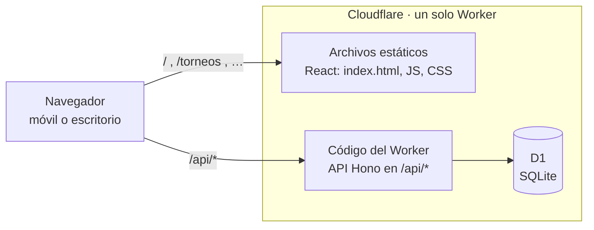
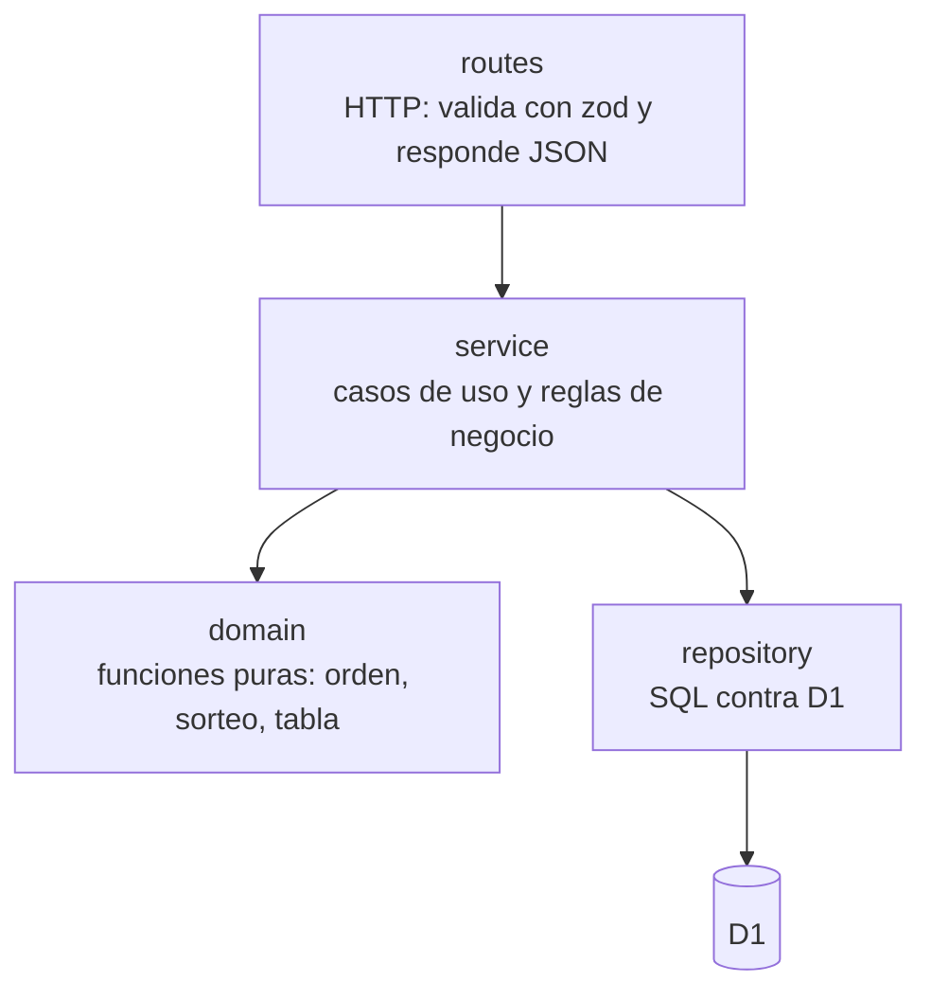
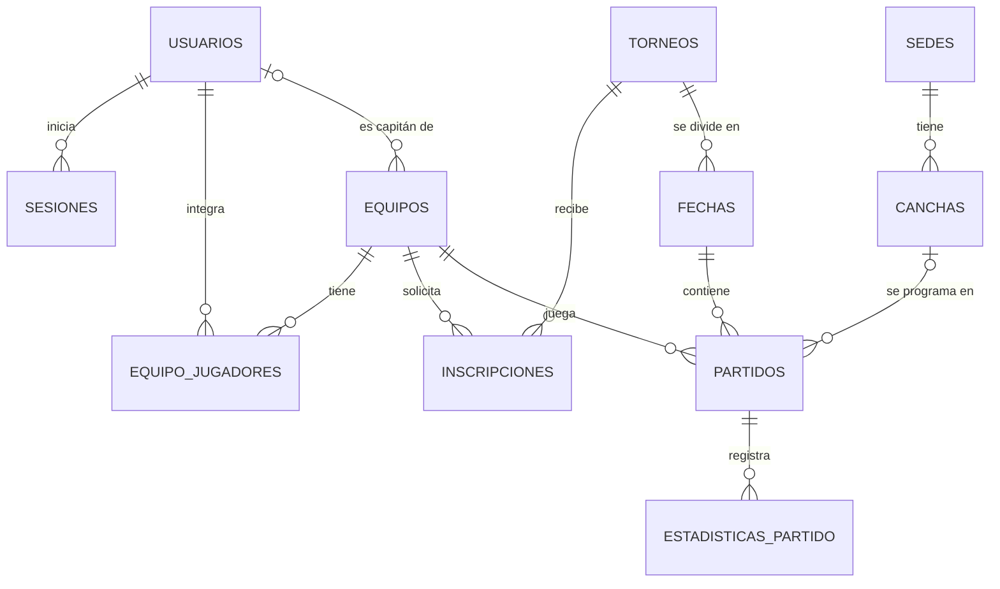

# Campeonatos UEB

Aplicación web responsive para gestionar campeonatos de fútbol 11 en formato liga: usuarios jugador y administrador, torneos, equipos, inscripciones, sorteo todos contra todos, programación de partidos, resultados y tabla de posiciones.

Proyecto de la materia _Tendencias Avanzadas en Ingeniería de Software Asistida por IA_ — Universidad El Bosque, 2026.

- Backlog y tablero: [Jira · UEB-IngSoftware2026 (KAN)](https://unbosque-team-ing-soft-2026.atlassian.net/jira/software/projects/KAN/boards/1)
- Convención: cada historia se llama `UEB-Proyect-##` en su título y tiene una clave de Jira `KAN-##`.
- **Guía de desarrollo para el equipo:** Consulta [DEVELOPMENT.md](./DEVELOPMENT.md) para el estándar de ramas, commits, migraciones y Definition of Done.

## Contenido

1. [Stack](#1-stack)
2. [Arquitectura](#2-arquitectura)
3. [Estructura de carpetas](#3-estructura-de-carpetas)
4. [Backend](#4-backend)
5. [Frontend](#5-frontend)
6. [Base de datos](#6-base-de-datos)
7. [Ejecutar en local](#7-ejecutar-en-local)
8. [Scripts](#8-scripts)
9. [Pruebas y cobertura](#9-pruebas-y-cobertura)
10. [Subir el proyecto a GitHub](#10-subir-el-proyecto-a-github)
11. [Despliegue en Cloudflare](#11-despliegue-en-cloudflare)
12. [Flujo de trabajo con Jira y GitHub](#12-flujo-de-trabajo-con-jira-y-github)
13. [Cómo implementar una historia](#13-cómo-implementar-una-historia)
14. [Límites y pendientes conocidos](#14-límites-y-pendientes-conocidos)

## 1. Stack

| Capa          | Tecnología                                                     | Por qué                                                                                         |
| ------------- | -------------------------------------------------------------- | ----------------------------------------------------------------------------------------------- |
| Frontend      | React 19 + React Router + Vite                                 | SPA mobile-first; Vite compila rápido y sirve el frontend y el backend en un solo `npm run dev` |
| Backend       | TypeScript + [Hono](https://hono.dev) sobre Cloudflare Workers | Framework liviano hecho para Workers; sin servidores que administrar                            |
| Validación    | zod (esquemas compartidos)                                     | Las mismas reglas validan el formulario y la API                                                |
| Base de datos | Cloudflare D1 (SQLite)                                         | Vive junto al Worker, sin otro proveedor ni costo en el plan gratuito                           |
| Pruebas       | Vitest + Testing Library + cobertura v8                        | Un solo runner para backend y frontend                                                          |
| Calidad       | ESLint + TypeScript estricto + Prettier                        | Lint y verificación de tipos en cada PR                                                         |
| CI/CD         | GitHub Actions + Wrangler                                      | Pruebas en cada PR; despliegue y aviso por webhook en cada merge a `main`                       |
| Gestión       | Jira + GitHub for Jira                                         | Ramas, commits, PR y despliegues visibles en cada historia                                      |

## 2. Arquitectura

Es un **monolito modular**: un solo repositorio, un solo build y **un solo despliegue** que contiene el frontend y el backend.



Cómo se reparte cada petición (configurado en `wrangler.jsonc`):

- **`/api/*`** la atiende siempre el Worker (`run_worker_first`), incluso si se abre en la barra del navegador.
- **Cualquier otra ruta** la sirve Cloudflare como archivo estático. Si el archivo no existe (por ejemplo `/torneos/123`), devuelve `index.html` y React Router decide qué pantalla mostrar (`not_found_handling: single-page-application`).

Decisiones principales:

| Decisión                            | Motivo                                                                                                                                                          |
| ----------------------------------- | --------------------------------------------------------------------------------------------------------------------------------------------------------------- |
| Monolito y no microservicios        | Un equipo pequeño, un MVP y un plan gratuito: un despliegue es más fácil de operar y de depurar. Los módulos internos permiten separarlo más adelante si crece. |
| Módulos por dominio (épicas)        | Cada épica de Jira tiene su carpeta; una historia toca casi siempre un solo módulo.                                                                             |
| Capas dentro de cada módulo         | Las reglas de negocio no dependen de HTTP ni de SQL, así que se prueban sin servidor ni base de datos.                                                          |
| Contrato compartido en `src/shared` | Tipos y validaciones viven en un solo lugar; si cambian, el compilador avisa en ambos lados.                                                                    |
| Seguro por defecto                  | Las rutas privadas y de administrador están protegidas por grupo desde el inicio; hasta implementar el login responden 401.                                     |

## 3. Estructura de carpetas

```text
ueb-campeonatos-futbol/
├── src/
│   ├── server/                      # BACKEND (Worker + Hono)
│   │   ├── index.ts                 # Punto de entrada del Worker
│   │   ├── app.ts                   # Monta los módulos y define qué rutas son públicas, con sesión o de admin
│   │   ├── core/                    # Transversal a todos los módulos
│   │   │   ├── env.ts               # Tipos de c.env (D1) y del contexto (usuario)
│   │   │   ├── errors.ts            # AppError + manejador global { codigo, mensaje, detalles }
│   │   │   ├── validacion.ts        # Convierte errores de zod al formato estándar
│   │   │   └── middleware/          # requireAuth, requireRole
│   │   ├── modules/                 # Un módulo por área del dominio (épicas de Jira)
│   │   │   ├── torneos/             # Módulo de referencia completo
│   │   │   │   ├── torneos.routes.ts       # HTTP: rutas, validación, respuesta
│   │   │   │   ├── torneos.service.ts      # Casos de uso y reglas de negocio
│   │   │   │   ├── torneos.repository.ts   # SQL contra D1
│   │   │   │   └── domain/                 # Funciones puras + sus pruebas
│   │   │   ├── auth/  usuarios/  equipos/  inscripciones/
│   │   │   ├── sorteo/  sedes/  partidos/  tabla/  health/
│   │   └── test/                    # Utilidades de prueba del backend (D1 falsa)
│   ├── client/                      # FRONTEND (React)
│   │   ├── main.tsx                 # Arranque de React y del router
│   │   ├── app/                     # Rutas, layout y páginas generales (404)
│   │   ├── features/                # Una carpeta por funcionalidad
│   │   │   └── torneos/             # api.ts · components/ · pages/
│   │   ├── common/                  # Reutilizable entre features: cliente HTTP, hooks, formato
│   │   ├── styles/                  # CSS global mobile-first
│   │   └── test/                    # Configuración y utilidades de prueba del frontend
│   └── shared/                      # CONTRATO compartido: tipos, constantes y esquemas zod
├── migrations/                      # Migraciones SQL de D1, en orden (0001_, 0002_, …)
├── seeds/                           # Datos de ejemplo solo para desarrollo local
├── public/                          # Archivos estáticos tal cual (favicon)
├── .github/
│   ├── workflows/ci.yml             # PR: lint, tipos, pruebas, cobertura, build
│   ├── workflows/deploy.yml         # main: pruebas, migraciones, deploy y webhook
│   └── pull_request_template.md     # Checklist de Definition of Done
├── .jira/config.yml                 # Mapeo de entornos para GitHub for Jira
├── index.html                       # HTML base de la SPA
├── wrangler.jsonc                   # Configuración del Worker, assets y D1
├── vite.config.ts                   # Build único: React + Worker
├── vitest.config.ts                 # Pruebas y umbral de cobertura
├── eslint.config.js                 # Reglas de lint y fronteras entre capas
└── tsconfig*.json                   # Un tsconfig por entorno: app (navegador), worker y node
```

**Fronteras entre capas** (las hace cumplir ESLint con `no-restricted-imports`):

- `src/client` no importa nada de `src/server`, y viceversa.
- Lo que ambos necesitan (tipos, constantes, esquemas) va en `src/shared`.
- `src/shared` no importa de ninguno de los dos.

## 4. Backend

### Capas de un módulo



| Capa              | Responsabilidad                                             | Sabe de HTTP | Sabe de SQL | Cómo se prueba                     |
| ----------------- | ----------------------------------------------------------- | ------------ | ----------- | ---------------------------------- |
| `*.routes.ts`     | Rutas, validación de entrada, código de respuesta           | Sí           | No          | Con `app.request()` y una D1 falsa |
| `*.service.ts`    | Casos de uso: aplica reglas, orquesta repositorio y dominio | No           | No          | Con un repositorio en memoria      |
| `domain/`         | Cálculos puros: ordenar, sortear, calcular puntos y tabla   | No           | No          | Pruebas unitarias directas         |
| `*.repository.ts` | Consultas SQL a D1                                          | No           | Sí          | Pruebas de integración             |

El módulo `torneos` ya recorre todas las capas (`GET /api/torneos`) y es el ejemplo a seguir.

### Seguridad por grupos de rutas

`src/server/app.ts` es el único lugar donde se decide qué es público y qué no:

| Grupo         | Prefijos                                                                             | Protección                             |
| ------------- | ------------------------------------------------------------------------------------ | -------------------------------------- |
| Públicas      | `/api/health`, `/api/auth`, `/api/torneos`\*                                         | Ninguna                                |
| Con sesión    | `/api/usuarios`, `/api/equipos`, `/api/inscripciones`, `/api/partidos`, `/api/tabla` | `requireAuth`                          |
| Administrador | `/api/admin/*`                                                                       | `requireAuth` + `requireRole('admin')` |

\* UEB-Proyect-10 pide sesión para ver torneos; `/api/torneos` pasa al grupo "con sesión" cuando esté el login (UEB-Proyect-04).

`requireAuth` valida la cookie HttpOnly `__Host-sesion` (Secure, Path=/, sin Domain) contra la tabla `sesiones` (24 h, usuario activo): sin sesión responde 401 `NO_AUTENTICADO` y con la sesión vencida 401 `SESION_EXPIRADA` (UEB-Proyect-04).

`POST /api/auth/registro` admite 5 peticiones por minuto por IP (binding `LIMITE_DE_REGISTRO`, sección `ratelimits` de `wrangler.jsonc`); al pasarse responde 429 `DEMASIADAS_PETICIONES`.

### Formato de respuestas

- Listas: `{ "datos": [ ... ] }`
- Errores: `{ "codigo": "SIN_PERMISO", "mensaje": "No tienes permiso…", "detalles": … }`

| Código HTTP | `codigo`               | Cuándo                                                  |
| ----------- | ---------------------- | ------------------------------------------------------- |
| 400         | `VALIDACION`           | Datos inválidos; `detalles` trae `[{ campo, mensaje }]` |
| 401         | `NO_AUTENTICADO`       | Sin sesión o sesión vencida                             |
| 403         | `SIN_PERMISO`          | El rol no alcanza                                       |
| 404         | `NO_ENCONTRADO`        | Recurso o ruta inexistente                              |
| 409         | Código propio del caso | Conflicto de negocio (ej. `EQUIPO_LLENO`)               |
| 500         | `ERROR_INTERNO`        | Error inesperado; nunca expone detalles internos        |

### Módulos y épicas

| Módulo          | Épica  | Historias           | Estado                                        |
| --------------- | ------ | ------------------- | --------------------------------------------- |
| `health`        | —      | Monitoreo           | Implementado                                  |
| `torneos`       | E3     | 07, 08, 09, **10**  | Listado (10) implementado como referencia     |
| `auth`          | E2     | **03**, **04**      | Registro (03), inicio y cierre de sesión (04) |
| `usuarios`      | E2     | 03, 05, 06, 17      | Dominio y caso de uso del registro (03)       |
| `equipos`       | E4, E5 | 11 a 17             | Pendiente                                     |
| `inscripciones` | E6     | 18, 19              | Pendiente                                     |
| `sorteo`        | E7     | 20                  | Pendiente                                     |
| `sedes`         | E8     | 21                  | Pendiente                                     |
| `partidos`      | E8, E9 | 22, 23, 24, 25      | Pendiente                                     |
| `tabla`         | E10    | 26 (27 es frontend) | Pendiente                                     |
| `core/`         | E1     | 02                  | Middleware listo; falta validar sesiones      |

Cada archivo `*.routes.ts` lista en su encabezado las historias que le corresponden.

## 5. Frontend

| Carpeta                     | Qué va ahí                                                                                       |
| --------------------------- | ------------------------------------------------------------------------------------------------ |
| `app/`                      | Rutas (`rutas.tsx`), layout principal y páginas generales como la 404                            |
| `features/<funcionalidad>/` | Todo lo de una funcionalidad: `api.ts` (llamadas a la API), `components/`, `pages/`              |
| `common/`                   | Lo reutilizable entre features: cliente HTTP (`pedir`), hooks (`useConsulta`), formato de fechas |
| `styles/`                   | CSS global, mobile-first: se diseña para 360 px y se amplía en 768 px y 1280 px                  |

Reglas:

- Toda llamada al backend pasa por `common/api/client.ts`, que agrega `/api`, pide JSON y convierte los errores en `ApiError` con el `codigo` del backend.
- Los tipos de las respuestas se importan de `@shared/…`, nunca se redefinen en el frontend.
- Una feature no importa archivos internos de otra feature; lo que se comparte se mueve a `common/`.

## 6. Base de datos

- Las migraciones están en `migrations/` y se aplican en orden. **Nunca se edita una migración ya aplicada**: cada cambio es un archivo nuevo.
- Crear una migración: `npx wrangler d1 migrations create DB descripcion_del_cambio`.
- `seeds/dev.sql` carga torneos de ejemplo **solo en local**.

Modelo de datos planeado según el backlog (hoy existen `torneos`, `usuarios`, `sesiones` e `intentos_inicio_sesion`; cada historia agrega sus tablas con su migración):



## 7. Ejecutar en local

Requisitos: **Node.js 22** (ver `.nvmrc`), npm y Git. Para desplegar, además, una cuenta gratuita de Cloudflare.

```bash
# 1. Clonar el repositorio
git clone https://github.com/daniachury/ueb-campeonatos-futbol.git
cd ueb-campeonatos-futbol

# 2. Si estás revisando la historia KAN-50 antes del merge:
git checkout feature/KAN-50-recuperar-cuenta

# 3. Instalar dependencias
npm install

# 4. Sincronizar Base de Datos Cloudflare D1 local (Aplica migraciones 0001 a 0013)
npm run db:migrate:local

# 5. Cargar datos de prueba (usuarios, equipos, torneos y canchas)
npm run db:seed:local

# 6. Iniciar servidor de desarrollo (Frontend Vite SPA + Backend Worker Hono)
npm run dev
```

Comprobar que todo responde:

- **Frontend:** <http://localhost:5173>
- **Iniciar sesión:** <http://localhost:5173/iniciar-sesion>
- **Recuperar cuenta (KAN-50):** <http://localhost:5173/recuperar-cuenta>
- **Health Check API:** <http://localhost:5173/api/health> → `{"estado":"ok","baseDeDatos":"ok"}`

### Usuarios y Credenciales de Prueba (Semillas Locales)

Al ejecutar `npm run db:seed:local`, se crean los siguientes usuarios con los que puedes ingresar o probar el flujo de recuperación de contraseña:

| Rol | Correo Electrónico | Contraseña por Defecto | Notas |
| :--- | :--- | :--- | :--- |
| **Administrador** | `admin@unbosque.edu.co` | `balon2026` | Acceso directo a `/admin` y gestión de torneos |
| **Capitán / Jugador** | `carlos@mail.com` | `balon2026` | Capitán de equipo con acceso a `/mis-equipos` |
| **Jugador Registrado** | `santiago.rincon@unbosque.edu.co` | `balon2026` | Integrante de plantilla fútbol 11 (Bosque FC) |
| **Aspirante** | `esteban.ospina@unbosque.edu.co` | `balon2026` | Solicitud de ingreso pendiente |

> [!NOTE]
> Para probar **KAN-50** en local:
> 1. Ve a <http://localhost:5173/recuperar-cuenta> o pulsa "¿Olvidaste tu contraseña?" en el login.
> 2. Ingresa `admin@unbosque.edu.co` o `carlos@mail.com`.
> 3. Pulsa "Recuperar cuenta" y haz clic en "Ir a restablecer contraseña".
> 4. Ingresa tu nueva contraseña (ej. `NuevaClave2026`, mínimo 8 caracteres alfanumérica).
> 5. Al guardar, serás redirigido a `/iniciar-sesion` para ingresar con tu nueva credencial.

No hace falta iniciar sesión en Cloudflare para trabajar en local.


## 8. Scripts

| Comando                                                    | Qué hace                                                                                                               |
| ---------------------------------------------------------- | ---------------------------------------------------------------------------------------------------------------------- |
| `npm run dev`                                              | Servidor de desarrollo con recarga: React + Worker + D1 local                                                          |
| `npm run build`                                            | Verifica tipos y genera el build de producción en `dist/`                                                              |
| `npm run preview`                                          | Build + servidor que imita producción                                                                                  |
| `npm run deploy`                                           | Migraciones en la D1 remota + build + despliegue manual en Cloudflare                                                  |
| `npm run lint`                                             | ESLint, incluidas las fronteras entre capas                                                                            |
| `npm run typecheck`                                        | TypeScript en los tres entornos (navegador, Worker y Node)                                                             |
| `npm run format` / `format:check`                          | Prettier                                                                                                               |
| `npm test` / `npm run test:watch`                          | Pruebas una vez / en modo observación                                                                                  |
| `npm run test:coverage`                                    | Pruebas con reporte de cobertura en `coverage/`                                                                        |
| `npm run test:ci`                                          | Lo que corre el CI: cobertura + resultados en `reports/test-results.json`                                              |
| `npm run db:migrate:local` / `db:migrate:remote`           | Aplica migraciones a la D1 local / de producción                                                                       |
| `npm run db:seed:local`                                    | Carga datos de ejemplo en la D1 local                                                                                  |
| `npx wrangler d1 execute DB --local --file=seeds/demo.sql` | Carga la Copa Liga Bosque 2026 (4 equipos, 2 sedes, fixture). Con `--remote`, en producción; no borra ni duplica datos |

## 9. Pruebas y cobertura

- Las pruebas viven **junto al código** que prueban: `torneos.service.ts` → `torneos.service.test.ts`.
- Backend: corren en Node. Las rutas se prueban con `app.request()` y una D1 falsa (`src/server/test/d1-falsa.ts`); los servicios, con repositorios en memoria.
- Frontend: los archivos de prueba empiezan con `// @vitest-environment jsdom` y usan Testing Library.
- **Umbral**: la cobertura de líneas debe ser de al menos **80 %** (Definition of Done). Si baja, `npm run test:coverage` falla y el CI también.
- En cada PR, el CI publica un comentario con la cobertura.

## 10. Subir el proyecto a GitHub

Una sola vez, por quien crea el repositorio:

```bash
npm install                       # genera package-lock.json: el CI lo necesita (npm ci)
git init -b main
git add .
git commit -m "chore: estructura inicial del monolito"
git remote add origin https://github.com/<usuario>/ueb-campeonatos-futbol.git
git push -u origin main
```

El `.gitignore` deja fuera `node_modules/`, `dist/`, `.wrangler/` (la base local), `coverage/`, `reports/`, `.env*` y `.dev.vars*`. Revisa con `git status` antes del primer commit que no aparezca ninguno de ellos.

Luego, en GitHub:

1. **Settings → Branches → Add rule** para `main`: exigir Pull Request, una aprobación y el check **"Lint, tipos, pruebas y build"**.
2. **Settings → Secrets and variables → Actions**: agregar los secretos de la sección 11.2.
3. En Jira: **Apps → GitHub for Jira** → conectar la organización o el repositorio.

## 11. Despliegue en Cloudflare

### 11.1 Primera vez (manual, desde tu computador)

```bash
npx wrangler login                          # abre el navegador para autorizar
npx wrangler d1 create ueb-campeonatos-db   # imprime el database_id
```

1. Copia el `database_id` que imprime el comando en `wrangler.jsonc` (reemplaza los ceros).
2. Despliega. `npm run deploy` aplica primero las migraciones pendientes en la D1 remota y solo después compila y publica, así el código nuevo nunca llega a producción antes que sus tablas:

```bash
npm run deploy
```

Nunca publiques con `npx wrangler deploy` directo: se salta las migraciones y, si el código nuevo usa una columna o tabla que todavía no existe, la API responde 500 (por ejemplo, el inicio de sesión).

Wrangler imprime la URL pública, de la forma `https://ueb-campeonatos-futbol.<tu-subdominio>.workers.dev`. Abre `/api/health` en esa URL para confirmar que el Worker y la D1 responden.

### 11.2 Automático (GitHub Actions)

Después de la primera vez, **cada merge a `main` se despliega solo** con `.github/workflows/deploy.yml`:

```text
npm ci → pruebas con cobertura → migraciones en D1 → build → wrangler deploy → aviso por webhook
```

Secretos del repositorio (**Settings → Secrets and variables → Actions**):

| Secreto                 | De dónde sale                                                                                                                             |
| ----------------------- | ----------------------------------------------------------------------------------------------------------------------------------------- |
| `CLOUDFLARE_API_TOKEN`  | Cloudflare → My Profile → API Tokens → Create Token → plantilla **Edit Cloudflare Workers**, y agregar el permiso de cuenta **D1 · Edit** |
| `CLOUDFLARE_ACCOUNT_ID` | Lo muestra `npx wrangler whoami` o el panel de Workers & Pages                                                                            |
| `DEPLOY_WEBHOOK_URL`    | Opcional. URL de un webhook de Discord, Slack o Teams para el aviso                                                                       |

El aviso del webhook incluye el resultado del despliegue, el commit, las pruebas pasadas sobre el total, la cobertura de líneas y el enlace a la ejecución. Si no se configura el secreto, el paso se omite sin fallar.

El job usa el entorno `production` de GitHub: así GitHub registra cada despliegue y GitHub for Jira lo muestra en las historias incluidas.

### 11.3 Reglas para no romper producción

- Las migraciones deben ser **aditivas** (agregar tablas o columnas). Se aplican antes del deploy: si el deploy falla, el código anterior sigue funcionando con la base nueva.
- Nunca ejecutar `seeds/dev.sql` contra la base remota.
- Actualiza `compatibility_date` en `wrangler.jsonc` de vez en cuando y despliega con las pruebas en verde.

## 12. Flujo de trabajo con Jira y GitHub

GitHub for Jira enlaza el trabajo usando la **clave de Jira (`KAN-##`)**, no el nombre `UEB-Proyect-##`. Por eso la clave va en la rama, en los commits y en el título del PR:

| Elemento      | Formato                         | Ejemplo                                                |
| ------------- | ------------------------------- | ------------------------------------------------------ |
| Rama          | `tipo/KAN-##-descripcion`       | `feature/KAN-27-unirse-a-equipo`                       |
| Commit        | Conventional Commits + clave    | `feat(equipos): KAN-27 valida el cupo de 25 jugadores` |
| Título del PR | `KAN-##: título de la historia` | `KAN-27: Unirme a un equipo`                           |

Tipos de rama y commit: `feature`, `fix`, `chore`, `docs`, `test`, `refactor`.

Recorrido de una historia:

1. Mover la historia a **En curso** y crear la rama desde `main`.
2. Implementar con sus pruebas (ver la sección 13).
3. Abrir el PR con la plantilla y completar el checklist.
4. El CI corre lint, tipos, pruebas y build, y comenta la cobertura.
5. Con una aprobación y el CI en verde, hacer merge: se despliega solo y llega el aviso por webhook.

## 13. Cómo implementar una historia

Ejemplo: **UEB-Proyect-14 · Unirme a un equipo** (`KAN-27`).

1. **Base de datos.** Si necesitas tablas nuevas: `npx wrangler d1 migrations create DB crear_equipos` y luego `npm run db:migrate:local`.
2. **Contrato** (`src/shared/`): tipos de respuesta y esquemas zod de entrada (ej. `equipos.ts`).
3. **Dominio** (`modules/equipos/domain/`): reglas como funciones puras, con pruebas para cada escenario de aceptación.
4. **Repositorio** (`equipos.repository.ts`): las consultas SQL.
5. **Servicio** (`equipos.service.ts`): el caso de uso; lanza `errores.conflicto(...)` cuando una regla no se cumple.
6. **Rutas** (`equipos.routes.ts`): valida con `zValidator(..., siFallaLaValidacion)` y llama al servicio. Revisa en `app.ts` que el prefijo esté en el grupo correcto.
7. **Frontend** (`src/client/features/equipos/`): `api.ts`, componentes y página; agrega la ruta en `app/rutas.tsx`.
8. **Pruebas**: `npm run test:coverage`, `npm run lint`, `npm run typecheck`.
9. **PR** con la clave `KAN-27` en el título.

## 14. Límites y pendientes conocidos

**Plan gratuito de Cloudflare Workers** (revisar los valores vigentes en la documentación de Cloudflare):

- 100.000 peticiones al día al Worker y 10 ms de CPU por petición.
- Las peticiones a archivos estáticos (el frontend) son gratuitas e ilimitadas.
- Evitar cálculos pesados en una sola petición. Para el hash de contraseñas (UEB-Proyect-03) la opción nativa en Workers es PBKDF2 con Web Crypto; medir su costo de CPU antes de fijar el número de iteraciones.

**Contraseñas (UEB-Proyect-03 · KAN-16, Escenario 5):** se guardan con **PBKDF2-SHA256** (100.000 iteraciones, el máximo de Workers, y sal aleatoria) en `usuarios/infraestructura/cifrador-pbkdf2.ts`, con el formato `pbkdf2_sha256$<iteraciones>$<sal>$<hash>`. Las cuentas creadas antes con el adaptador provisional (contraseña sin hash) siguen entrando y se vuelven a guardar con hash en su siguiente inicio de sesión. La contraseña nunca sale en las respuestas de la API.

**Pendientes del esqueleto:**

- UEB-Proyect-04: falta el cambio obligatorio de contraseña temporal del administrador (depende de UEB-Proyect-05) y la pantalla real de Gestión de torneos (épica E3).
- `GET /api/torneos` es pública por ahora; debe pasar al grupo con sesión (UEB-Proyect-10).
- El menú por rol y el menú hamburguesa son parte de UEB-Proyect-01.
- Las pruebas de repositorio contra una D1 real se pueden agregar con `@cloudflare/vitest-pool-workers`.
- Las reglas de `src/shared/constants.ts` (11 a 25 jugadores, 3 a 20 equipos, puntos 3/1/0, partidos de 2 horas) están pendientes de validar con el docente.

## 15. Módulo de Recuperación de Cuenta y Gobernanza (KAN-50)

### 15.1. Funcionalidad del Módulo
La historia **KAN-50** (`UEB-Proyect-50 · Recuperación de cuenta y restablecimiento de contraseña con redirección inmediata`) implementa el flujo de autoservicio para usuarios con roles autorizados (`jugador`, `capitan`, `admin`) que no recuerdan sus credenciales:
1. **Solicitud de Recuperación (`/recuperar-cuenta`):** El usuario ingresa su correo institucional UEB. El sistema valida la existencia y rol permitido. Al no requerir servicio de correo externo (SMTP), genera un token criptográfico seguro de 32 bytes hexadecimales, presenta el enlace en pantalla y ofrece un botón de redirección inmediata a `/restablecer-contrasena?token=...`.
2. **Validación de Token:** El token expira en 15 minutos, es de un solo uso (`usado_en IS NULL`) y cuenta con verificación previa vía `GET /api/auth/validar-token-recuperacion?token=...`.
3. **Restablecimiento Seguro (`/restablecer-contrasena`):** Permite ingresar y confirmar la nueva contraseña, validando de forma estricta $\ge 8$ caracteres alfanuméricos con letras y números obligatorios (`REGLAS_CONTRASENA`). La nueva clave es cifrada mediante PBKDF2-SHA256 (100.000 iteraciones con sal criptográfica única) e invalida de inmediato el token consumido.
4. **Diseño Visual:** Interfaz desarrollada con el sistema *v3 · Neón minimal*, consumiendo tokens oficiales de `tema.css`, diseño mobile-first y estados accesibles (ARIA).

### 15.2. Gobernanza y Automatización con Skills y Hooks
El desarrollo del módulo se ejecutó bajo la disciplina de ingeniería de software definida en `.agents/`:

- **Skills Utilizadas:**
  - `ueb-control-proyecto`: Orquestación del ciclo de 9 pasos, trazabilidad con historias Jira KAN, ramificación `feature/KAN-50-recuperar-cuenta` y compuertas de aprobación obligatoria.
  - `ueb-controles-ci-cd`: Ejecución estricta de los 4 controles de calidad locales (`npm run lint`, `npm run typecheck`, `npm run test:coverage` con cobertura $\ge 80\%$, y `npm run build`).
  - `ueb-stack-arquitectura`: Adhesión a la arquitectura hexagonal en Cloudflare Workers + Hono v4, esquemas Zod en `src/shared/` y persistencia SQL en D1.
  - `ueb-restricciones-negocio`: Restricción estricta de roles autorizados (`jugador`, `capitan`, `admin`), contraseñas alfanuméricas $\ge 8$ caracteres y auditoría.
  - `ueb-diseno-v3-neon`: Paleta Neón minimal, CSS Modules, móvil primero y prevención de renders en cascada en React.

- **Hooks Activos en el Ciclo:**
  - `validar-inmutabilidad-migraciones.cjs`: Garantiza que las migraciones aplicadas `0001_` a `0012_` sean de sólo lectura, forzando la creación de `0013_crear_tokens_recuperacion.sql`.
  - `validar-seguridad-git.cjs`: Intercepta comandos de consola para impedir `git commit`, `git push` o bypass de hooks (`--no-verify`) sin autorización humana explícita.
  - `verificar-diseno-react.cjs`: Analiza estáticamente archivos `.tsx` y `.css` para bloquear antipatrones visuales (como usar `--color-acento` como color de texto o llamadas a `setState` síncronas en `useEffect`).
  - `recordatorio-protocolo.cjs`: Emite recordatorios de cumplimiento al planificar o ejecutar tareas críticas.

